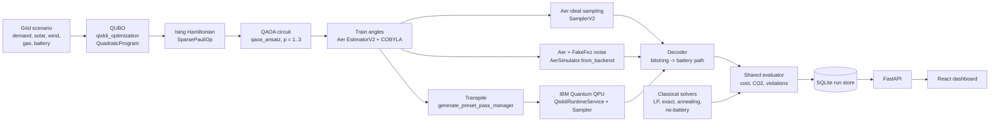
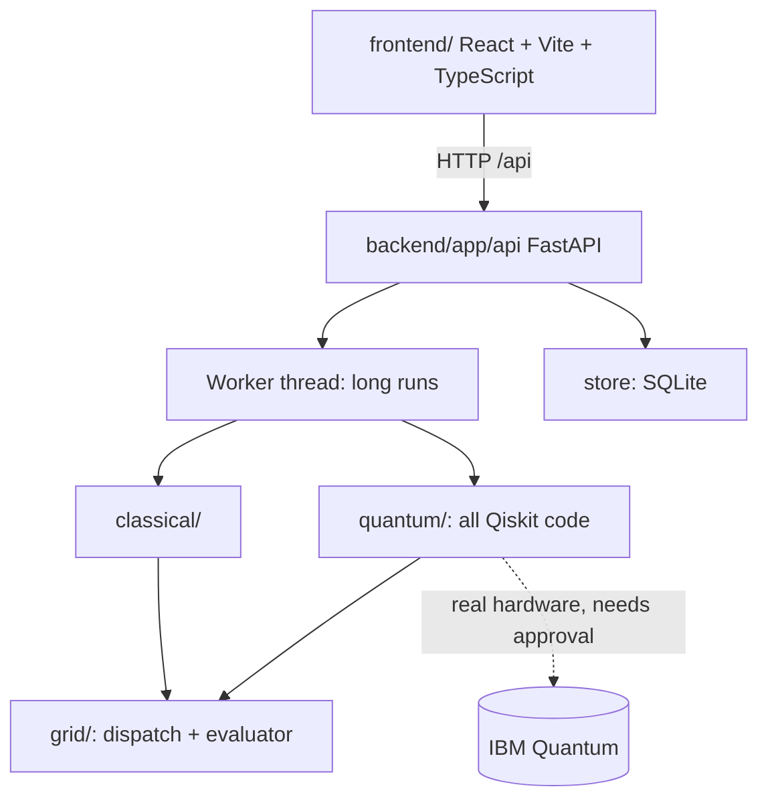

# Architecture

GitHub renders the diagrams below (Mermaid).

## End-to-end pipeline

Every solver, classical or quantum, is scored by the **same evaluator**, so the comparison is fair. The frontend contains no optimization logic.

## Software layers

## How a battery plan becomes qubits

| Tier | Encoding | Qubits |
|---|---|---|
| Q3 | one bit per hour: battery level 0 or 20 MWh | 3 |
| Q9 | one-hot over {0, 20, 40} per hour | 9 |
| Q18 | one-hot over {0, 10, ..., 50} per hour | 18 |
| Q3U | one-hot over (level in {0, 20}) x (gas unit on/off) per hour: unit commitment | 12 |
| Q9U | one-hot over (level in {0, 20, 40}) x (gas on/off) per hour: unit commitment | 18 |

QUBO energy = sum of per-hour dollar costs (given the battery change between consecutive hours) + a penalty for invalid plans. The ground state of that energy is the cheapest valid plan, which is verified exhaustively in the tests.

## Optional model features (Scenario C turns them all on)

| Feature | Evaluator | QUBO | Classical solver |
|---|---|---|---|
| Unit commitment (gas on/off, minimum output, start-up cost) | start-up cost, `gas_off` / `min_output` violations | state = (battery level, gas on/off); start-up couples two consecutive hours, so energy stays quadratic | MILP with binary on/off and start-up variables |
| Forecast uncertainty (weighted weather cases) | expected cost over cases, worst case reported | each hour's cost averaged over cases | two-stage stochastic MILP: battery and commitment shared, dispatch per case |
| Reserve margin | shortfall in MW and a penalty | shortfall penalty in each hour's cost | shortfall variable per case |

The QUBO and the evaluator call the same function (`outcome_parts` in `grid/evaluator.py`), which is what keeps "QUBO energy equals evaluator objective" true for every plan.

## Safety rules built into the code

- Unit-commitment tiers (Q3U, Q9U) are rejected by the hardware endpoint: 640-1,560 two-qubit gates is far too deep for today's chips.
- Real hardware needs an explicit `confirm` (`--yes` in the script, a checkbox in the UI), and every job is capped at 60 s of QPU time.
- Simulator results can never carry the `ibm_hardware` label; each result records its source, backend, job id, shots and library versions.
- IBM credentials only live in `backend/.env`, which is git-ignored.
